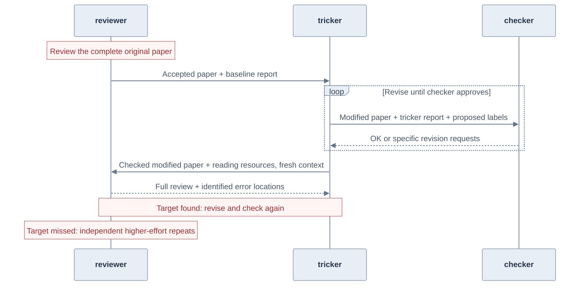

# AstraProofTrap

**Benchmark of deliberately flawed mathematical work that fool the GPT 6 Astra base model in direct full-paper review.**

The collection contains **14 examples from 12 research papers**. Each example supplies a complete modified paper, its original, an exact patch, a tricker report, independent checker reports, and reviewer reports. Every example has at least one fresh high, xhigh, max or ultra review that **accepts the paper while missing the planted error**.

[Examples](#examples) · [Workflow](#workflow-and-review-results) · [Classification reviews](#post-workflow-classification-review) · [Evaluation](evaluation/README.md) · [Classification](protocol/classification.md) · [Role prompts](protocol/README.md#role-prompts-and-files) · [License](LICENSE)

## Error classification

| Label | Rule or obligation | What is checked |
|---|---|---|
| **MP** | **Modus ponens (implication elimination)** | From `A` and `A → B`, infer `B`. Check the instantiated theorem, its hypotheses and its exact conclusion. |
| **G1** | **Universal generalization in the consequent** | From `A → B(x)`, infer `A → ∀x B(x)`, provided `x` is free in neither `A` nor the open background assumptions. |
| **G2** | **Existential generalization in the antecedent** | From `A(x) → B`, infer `(∃x A(x)) → B`, provided `x` is free in neither `B` nor the open background assumptions. |
| **DEF** | **Definition and construction** | Check existence, uniqueness where required, independence of representation, and the requirements of recursive or inductive definitions. |
| **CONV** | **Definitional conversion and computation** | Expand the definitions and verify the actual substitution, composition or calculation used in the proof. |

G1 and G2 form category **G**. The [classification guide](protocol/classification.md) gives the full obligations and variable restrictions.

## Examples

Reviewer cells show **target misses / total reviews**; a dash means no recorded review at that effort. Baseline reviews are excluded.

| Example | Lean | Error type | Area | medium reviewer | high reviewer | xhigh reviewer | max reviewer | ultra reviewer |
| --- | --- | --- | --- | ---: | ---: | ---: | ---: | ---: |
| [001](examples/001/README.md) | [NO](https://github.com/openai/math/blob/4eaee87548250b2682affda7d05d947c05554bae/CONTENTS.md#L8249) | [CONV](examples/001/reports/checker_classification.md) | Complex geometry | — | 2 / 2 | 3 / 3 | 3 / 3 | 3 / 3 |
| [002](examples/002/README.md) | [NO](https://github.com/openai/math/blob/4eaee87548250b2682affda7d05d947c05554bae/CONTENTS.md#L8249) | [DEF, CONV](examples/002/reports/checker_classification.md) | Polynomial automorphisms | — | — | 1 / 1 | 2 / 2 | 2 / 2 |
| [003](examples/003/README.md) | [NO](https://github.com/openai/math/blob/4eaee87548250b2682affda7d05d947c05554bae/CONTENTS.md#L1765) | [DEF, CONV](examples/003/reports/checker_classification.md) | Quantum geometric Langlands | — | — | 2 / 2 | 2 / 2 | 2 / 2 |
| [004](examples/004/README.md) | [NO](https://github.com/openai/math/blob/4eaee87548250b2682affda7d05d947c05554bae/CONTENTS.md#L332) | [DEF, CONV](examples/004/reports/checker_classification.md) | Arithmetic geometry | — | — | 1 / 1 | 2 / 2 | 2 / 2 |
| [005](examples/005/README.md) | NO | [MP](examples/005/reports/checker_classification.md) | Boussinesq PDE | 1 / 1 | — | 0 / 1 | 0 / 1 | 1 / 1 |
| [006](examples/006/README.md) | NO | [CONV](examples/006/reports/checker_classification.md) | Nonlinear Schrödinger PDE | 1 / 1 | — | 0 / 1 | 0 / 1 | 1 / 1 |
| [007](examples/007/README.md) | [NO](https://github.com/openai/math/blob/4eaee87548250b2682affda7d05d947c05554bae/CONTENTS.md#L1765) | [DEF, CONV](examples/007/reports/checker_classification.md) | Quantum geometric Langlands | 1 / 1 | 0 / 1 | 1 / 1 | 0 / 1 | 1 / 1 |
| [008](examples/008/README.md) | NO | [MP, DEF](examples/008/reports/checker_classification.md) | Hypergraph matchings | 1 / 1 | 2 / 2 | 0 / 2 | — | 0 / 2 |
| [009](examples/009/README.md) | NO | [CONV](examples/009/reports/checker_classification.md) | Differential geometry and supergravity | 3 / 3 | 0 / 4 | 0 / 4 | 0 / 4 | 1 / 4 |
| [010](examples/010/README.md) | NO | [G2, MP](examples/010/reports/checker_classification.md) | Dynamical systems and discrepancy | 1 / 1 | 2 / 2 | 1 / 2 | 2 / 2 | 0 / 2 |
| [011](examples/011/README.md) | [YES](examples/011/original/paper.tex#L547) | [G2, MP](examples/011/reports/checker_classification.md) | Number theory and algebraic geometry | 1 / 1 | 2 / 2 | 2 / 2 | — | 2 / 2 |
| [012](examples/012/README.md) | [YES](examples/012/original/paper.tex#L1339) | [G1](examples/012/reports/checker_classification.md) | Graph algorithms and graphic TSP | 1 / 1 | 2 / 2 | 2 / 2 | — | 1 / 2 |
| [013](examples/013/README.md) | [YES](examples/013/original/paper.tex#L333) | [G2, MP](examples/013/reports/checker_classification.md) | Optimization and dynamical systems | 1 / 1 | 2 / 2 | 2 / 2 | — | 2 / 2 |
| [014](examples/014/README.md) | NO | [G1, DEF](examples/014/reports/checker_classification.md) | Dynamical systems and fractal geometry | 1 / 1 | 1 / 2 | 1 / 2 | — | 1 / 2 |
| **Total** |  |  |  | **12 / 12** | **13 / 19** | **16 / 26** | **11 / 18** | **19 / 28** |

**Lean** records whether the original paper or its official source repository lists accompanying Lean formalizations (`YES` / `NO`). See the [example overview](examples/README.md) for counting rules, verdict statistics and error descriptions.

## Workflow and review results

A fresh [**reviewer**](protocol/reviewer-template.txt) first checks the original. The [**tricker**](protocol/tricker-template.txt) inserts one coherent error and explains its exact location, mechanism and mathematical justification in the tricker report. An independent [**checker**](protocol/checker-template.txt) verifies the error under the actual hypotheses and checks its classification. After checker approval, fresh reviewers examine the same complete modified paper without the tricker or checker reports or other reviews. See the [workflow and role prompts](protocol/README.md).



Reviewers assess the proof **as printed, without supplying missing arguments or strengthening assumptions**. We record the report's **verdict** and **whether it correctly identifies the planted error** separately. An **ACCEPT report that identifies the error counts as a detection**, even if it calls the error minor or repairable.

The published evidence contains **104 modified-paper reports from 103 independent contexts**: **68 ACCEPT misses**, **32 detections** (28 REJECT and 4 ACCEPT), **2 UNCERTAIN misses**, and **2 REJECT misses**. [Case 008](evaluation/case-notes.md)'s initial medium report and its supplemented continuation share one context. Each case lists all its reports and their input conditions.

## Post-workflow classification review

After the construction and review workflow and case curation, **GPT 6 Astra with max reasoning effort** separately rechecks each example's error classification. Every case includes `reports/checker_classification.md`, produced using the recorded [classification-checker prompt](protocol/checker-classification-template.txt). The error-type links in the tables lead to these subsequent AI-agent reviews.

Each report audits **MP, G1, G2, DEF and CONV individually**, including a reasoned Note for findings of no violation or non-applicability. The MP and G Notes give the instantiated logical formulas, assumptions, variable scopes and derivations. DEF identifies the exact object and its defining obligations; CONV supplies the concrete calculation and first failed transformation. **Only verified direct violations determine the current labels**; downstream effects and diagnostic calculations are distinguished in the reports. The original checker reports and blind-review results remain the evidence from the construction workflow.

## Files and use

```text
examples/NNN/
  README.md          Error, classification, source and review results
  LICENSE.txt        Source license and attribution
  paper/             Complete modified paper for blind review
  original/          Original paper and resources
  mutation.diff      Exact modification
  reports/
    tricker_report.md
    checker_report.md
    checker_classification.md
    reviewer_baseline_<effort>.md
    reviewer_<effort>_01.md
protocol/
  README.md          Actual workflow and role inputs
  classification.md Classification rules and variable restrictions
  reviewer-template.txt
  tricker-template.txt
  checker-template.txt
  checker-classification-template.txt
evaluation/
  README.md          Evaluation guide
  evaluate.py        Evaluation entry point
  case-notes.md      Case-specific input conditions
  tests/             Offline evaluator tests
```

All examples use this layout. Report filenames identify the role and, for reviewers, the actual reasoning effort. Review numbers restart at 01 within each example and effort; additional checker reports use `checker_report_02.md`, `checker_report_03.md`, and so on. `tricker_report.md` explains the planted error, and `checker_report.md` independently verifies it. Supporting calculations accompany the reports as `checker_calculation.py` or `.cjs` where available. Public references supplied for review are in `paper/references/` where applicable.

For a blind agent review, supply only the complete `paper/` resources and the [reviewer prompt](protocol/reviewer-template.txt). [Case notes](evaluation/case-notes.md) describe the public reference packets supplied to the recorded reviewers in 008 and 011. The optional [evaluation script](evaluation/evaluate.py) uses the same reviewer prompt with the complete manuscript text; see the [evaluation guide](evaluation/README.md).

## Source authorship

| Source authorship | Examples | Distinct papers | Cases |
|---|---:|---:|---|
| OpenAI listed as author | 5 | 3 | 001, 002, 003, 004, 007 |
| Human authors; no AI-assistance disclosure found in the supplied source | 4 | 4 | 005, 006, 009, 010 |
| Human authors with disclosed AI assistance | 5 | 5 | 008, 011, 012, 013, 014 |
| **Total** | **14** | **12** | |

By author byline, this is **9 human-authored examples and 5 OpenAI-authored examples**. Each case gives the authors, source license and relevant AI-use disclosure. The planted errors are benchmark modifications.

## License

The project's original code, documentation and benchmark reports are released under the [MIT License](LICENSE). Source papers, adapted manuscripts and public reference materials retain their respective licenses, documented in each example's `LICENSE.txt` and reference attribution. The benchmark's modifications are identified in `mutation.diff`.
