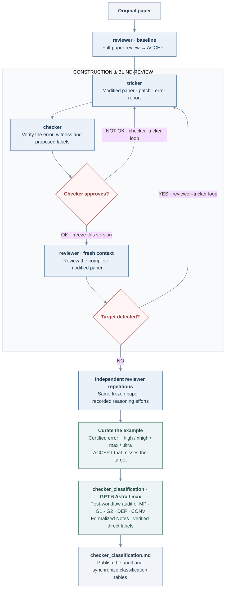

# Construction and review workflow

The construction workflow uses **reviewer**, **tricker**, and **checker**, with a coordinator managing their inputs and comparing reports with the certified error. After case curation, the **checker_classification** agent performs the five-item classification audit.

| Role | Input | Output |
|---|---|---|
| **reviewer** | Complete current paper and its reading resources; any specified public references. | ACCEPT / REJECT / UNCERTAIN and a full report locating and explaining every identified invalid proof step. |
| **tricker** | Original paper, accepted baseline report, and relevant feedback. | Complete modified paper, exact patch, and a report explaining one coherent mathematical error with proposed labels. |
| **checker** | Complete modified paper, tricker report, and classification rules. | OK / NOT OK, independent mathematical justification, classification and any required revisions. |
| **checker_classification** | Curated case, source and construction/checker materials, and classification rules. | Post-workflow five-item audit with formalized Notes and verified direct labels, produced by GPT 6 Astra / max. |

## Workflow diagram

## Procedure

1. A fresh reviewer reads the complete original paper. An accepted baseline supplies the starting point for construction.
2. The tricker inserts a substantive proof error while preserving a complete, natural paper. It records the exact change, actual hypotheses, a rigorous counterexample or failure proof, consequences and classification.
3. A fresh checker independently verifies the alleged error and its admissibility. It checks the affected argument in the context of the whole paper and evaluates MP, G1, G2, DEF and CONV. Feedback returns to the tricker until the modified paper and tricker report receive OK.
4. Freeze that version. A fresh reviewer receives the complete modified paper and reading resources, without the original, patch, labels or any other reports. Compare the returned report with the precise target. During construction, a detected target returns to the tricker and any new version must be checked again.
5. Run independent repetitions on the identical frozen paper at higher reasoning efforts. Record each actual effort and report. The collection requires a genuine certified error and at least one high, xhigh, max or ultra ACCEPT that misses it.

The current review instruction requires assessment **as printed**: no silent repair, added assumptions or substituted proof. Reviewers must identify invalid steps even when locally repairable. A correction in the report counts as detection.

## Reading the results

Record the overall verdict and target detection separately. A review detects the target when it correctly identifies the planted invalid step or missing necessary hypothesis, or explicitly corrects that step. Calling it minor while giving ACCEPT still counts as detection. Silent use of an unstated stronger hypothesis while endorsing the printed argument leaves the target missed.

An **ACCEPT miss** requires both acceptance and failure to identify the target. Merely mentioning the affected section or finding a different error is not target detection. A REJECT can therefore miss the planted target. Completed report records and independent contexts are counted separately when a review has a continuation.

## Post-workflow classification review

Once the original workflow and case curation are complete, a subsequent **GPT 6 Astra agent at max reasoning effort** reviews each frozen example's classification. It receives the complete modified paper, relevant original material and patch, tricker and checker reports, supporting calculations, and the classification rules. The review independently checks those materials and records its findings in `reports/checker_classification.md`.

The [classification-checker prompt](checker-classification-template.txt) requires five separate audits: **MP, G1, G2, DEF and CONV**. Each has a status, a direct/downstream/diagnostic role, exact locations and a full Note, including the concrete reason when no violation is found. MP and G Notes explicitly formalize the actual inference and all relevant assumptions and variable dependencies. DEF Notes identify the introduced object and the failed defining requirement; CONV Notes calculate the actual expressions and identify the first failed step. Verified direct findings supply the published labels. This later classification review is identified separately from the original checker and reviewer reports.

## Role prompts and files

- [Reviewer](reviewer-template.txt): the current whole-paper review instruction, including the no-repair condition.
- [Tricker](tricker-template.txt): error construction and tricker report.
- [Checker](checker-template.txt): independent verification using the [classification rules](classification.md).
- [Classification checker](checker-classification-template.txt): the subsequent five-item classification review after the original workflow and curation.

Every case has `README.md`, `LICENSE.txt`, `mutation.diff`, `paper/`, `original/` and `reports/`. Use `tricker_report.md`, `checker_report.md`, `checker_classification.md`, `reviewer_baseline_<effort>.md` and `reviewer_<effort>_01.md`. Reviewer numbering restarts within each case and effort; additional checker reports use `checker_report_02.md`, `checker_report_03.md`, and so on. Supporting calculations are report attachments named `checker_calculation.py` or `.cjs`; public reference packets belong in `paper/references/`.
